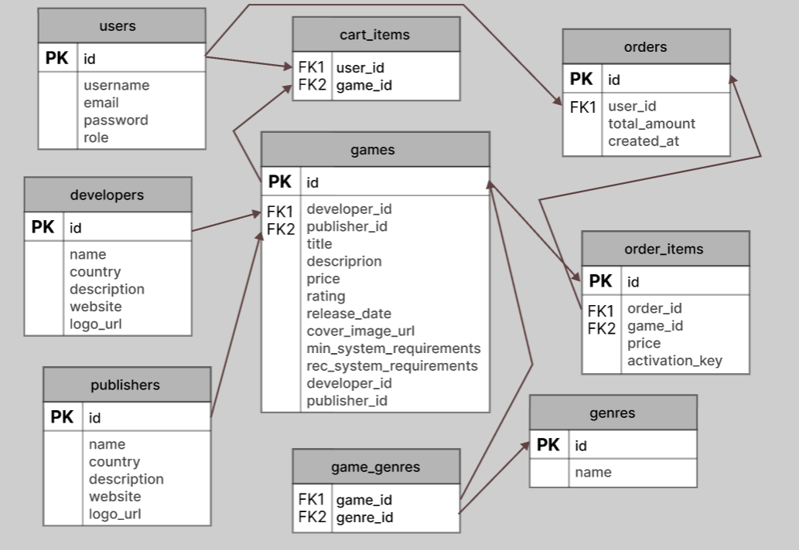

# GameFreedom

Сайт-магазин цифрових відеоігор. Тут можна подивитись список ігор, знайти потрібну, а авторизовані користувачі можуть додавати, редагувати та видаляти контент.

---

## Опис проєкту

Ідея схожа на спрощений Steam. Є каталог ігор, у кожної гри є своя сторінка з описом, ціною та рейтингом. Ігри мають розробника (студія, яка зробила гру) і видавця (компанія, яка її випускає), а також один або кілька жанрів.

### Що можна робити на сайті

**Будь-який відвідувач (неавторизований):**
- дивитись список ігор, розробників, видавців та жанрів;
- шукати гру за назвою;
- фільтрувати за жанром, розробником, видавцем і ціною;
- сортувати за ціною, рейтингом і датою виходу;
- відкрити сторінку окремої гри, розробника чи видавця;
- зареєструватись і залогінитись.

**Авторизований користувач:**
- додає, редагує і видаляє ігри, розробників, видавців і жанри.

---

## Авторизація та права доступу (JWT)

Для автентифікації використовується **JWT (JSON Web Token)** (`djangorestframework-simplejwt`).

- Після успішного логіну сервер повертає два токени: `access` (діє 60 хвилин) та `refresh` (діє 1 день).
- Для доступу до захищених ендпоінтів (`POST`, `PUT`, `PATCH`, `DELETE`) у запиті потрібно передавати заголовок:
  ```http
  Authorization: Bearer <access_token>
  ```
- **Права доступу (`IsAuthenticatedOrReadOnly`):** усі `GET`-запити відкриті для будь-кого, а запити на зміну даних (`POST`, `PUT`, `PATCH`, `DELETE`) доступні лише авторизованим користувачам. Якщо токен відсутній або невалідний, повертається статус **`401 Unauthorized`**:
  ```json
  {
    "detail": "Authentication credentials were not provided."
  }
  ```

---

## Ендпоінти API

Дані передаються у форматі JSON. Усі шляхи починаються з `/api`.

### Реєстрація та JWT-автентифікація (`/api/accounts`)

#### POST `/api/accounts/register/`
Створює нового користувача. Пароль зберігається в базі даних виключно в захешованому вигляді.

**Параметри запиту (Request body):**
- `username` (обов'язкове, max 30 символів)
- `email` (обов'язкове, унікальне, коректний формат email, max 100 символів)
- `password` (обов'язкове, мінімальна довжина та перевірка складності)
- `password_confirmation` (обов'язкове, має збігатися з `password`)
- `first_name` (необов'язкове, max 30 символів)
- `last_name` (необов'язкове, max 30 символів)

Request body:
```json
{
  "username": "gamer99",
  "first_name": "Dmytro",
  "last_name": "Sukhodolskyi",
  "email": "gamer99@example.com",
  "password": "StrongPassword123!",
  "password_confirmation": "StrongPassword123!"
}
```
Response: `201 Created`
```json
{
  "message": "Користувача успішно зареєстровано!"
}
```
Якщо поля заповнені некоректно або паролі не збігаються, повертається `400 Bad Request` з описом помилок для кожного поля.

#### POST `/api/accounts/login/`
Вхід в акаунт та отримання пари JWT-токенів.

Request body:
```json
{
  "username": "gamer99",
  "password": "StrongPassword123!"
}
```
Response: `200 OK`
```json
{
  "refresh": "eyJhbGciOiJIUzI1NiIsInR5cCI6IkpXVCJ9...",
  "access": "eyJhbGciOiJIUzI1NiIsInR5cCI6IkpXVCJ9..."
}
```
Якщо логін або пароль неправильні, повертається `401 Unauthorized`:
```json
{
  "detail": "No active account found with the given credentials"
}
```

#### POST `/api/accounts/token/refresh/`
Оновлення простроченого `access`-токена за допомогою `refresh`-токена.

Request body:
```json
{
  "refresh": "eyJhbGciOiJIUzI1NiIsInR5cCI6IkpXVCJ9..."
}
```
Response: `200 OK`
```json
{
  "access": "eyJhbGciOiJIUzI1NiIsInR5cCI6IkpXVCJ9..."
}
```
Якщо `refresh`-токен невалідний або прострочений, повертається `401 Unauthorized`.

---

### Ігри

#### GET `/api/games/`
Список ігор для головної сторінки каталогу (доступно всім).

Query-параметри (всі необов'язкові):

| Параметр | Що робить |
|----------|-----------|
| `search` | пошук за назвою |
| `genre_id` | фільтр за жанром |
| `developer_id` | фільтр за розробником |
| `publisher_id` | фільтр за видавцем |
| `min_price`, `max_price` | діапазон ціни |
| `sort_by` | сортування: `price`, `rating` або `release_date` |
| `order` | `asc` (за зростанням) або `desc` (за спаданням) |

Приклад запиту: `/api/games/?genre_id=1&sort_by=price&order=asc`

Response: `200 OK`
```json
[
  {
    "id": 10,
    "title": "Cyber Odyssey 2088",
    "price": "59.99",
    "rating": "4.8",
    "release_date": "2025-11-20",
    "developer": { "id": 2, "name": "Neon Interactive" },
    "publisher": { "id": 1, "name": "Global Games" },
    "genres": [
      { "id": 1, "name": "RPG" }
    ]
  }
]
```

#### GET `/api/games/{id}/`
Сторінка однієї гри з повною інформацією (доступно всім). Повертає `200 OK` або `404 Not Found`.

#### POST `/api/games/` (потрібен токен)
Додати нову гру. Потрібен заголовок `Authorization: Bearer <access_token>`.

Request body:
```json
{
  "title": "Mystic Realms",
  "description": "Фентезійна стратегія.",
  "price": 39.99,
  "rating": 9.2,
  "release_date": "2026-03-15",
  "developer_id": 1,
  "publisher_id": 1,
  "genre_ids": [1]
}
```
Response: `201 Created` (або `400 Bad Request` / `401 Unauthorized`).

#### PATCH `/api/games/{id}/` (потрібен токен)
Редагувати гру (можна передати тільки ті поля, які міняємо). Повертає `200 OK`, `400 Bad Request`, `401 Unauthorized` або `404 Not Found`.

#### DELETE `/api/games/{id}/` (потрібен токен)
Видалити гру. Повертає `204 No Content`, `401 Unauthorized` або `404 Not Found`.

---

### Розробники

| Метод | Шлях | Для чого | Доступ | Статус |
|-------|------|----------|--------|--------|
| GET | `/api/developers/` | список усіх розробників | усі | `200 OK` |
| GET | `/api/developers/{id}/` | деталі розробника | усі | `200 OK` / `404` |
| GET | `/api/developers/{id}/games/` | усі ігри розробника | усі | `200 OK` / `404` |
| POST | `/api/developers/` | додати розробника | авторизовані (`Bearer`) | `201 Created` / `401` |
| PUT | `/api/developers/{id}/` | редагувати розробника | авторизовані (`Bearer`) | `200 OK` / `401` / `404` |
| DELETE | `/api/developers/{id}/` | видалити розробника | авторизовані (`Bearer`) | `204 No Content` / `401` / `409` |

---

### Видавці

| Метод | Шлях | Для чого | Доступ | Статус |
|-------|------|----------|--------|--------|
| GET | `/api/publishers/` | список усіх видавців | усі | `200 OK` |
| GET | `/api/publishers/{id}/` | деталі видавця | усі | `200 OK` / `404` |
| GET | `/api/publishers/{id}/games/` | усі ігри видавця | усі | `200 OK` / `404` |
| POST | `/api/publishers/` | додати видавця | авторизовані (`Bearer`) | `201 Created` / `401` |
| PUT | `/api/publishers/{id}/` | редагувати видавця | авторизовані (`Bearer`) | `200 OK` / `401` / `404` |
| DELETE | `/api/publishers/{id}/` | видалити видавця | авторизовані (`Bearer`) | `204 No Content` / `401` / `409` |

---

### Жанри

| Метод | Шлях | Для чого | Доступ | Статус |
|-------|------|----------|--------|--------|
| GET | `/api/genres/` | список жанрів | усі | `200 OK` |
| GET | `/api/genres/{id}/` | деталі жанру | усі | `200 OK` / `404` |
| POST | `/api/genres/` | додати жанр | авторизовані (`Bearer`) | `201 Created` / `401` |
| PUT | `/api/genres/{id}/` | редагувати жанр | авторизовані (`Bearer`) | `200 OK` / `401` / `404` |
| DELETE | `/api/genres/{id}/` | видалити жанр | авторизовані (`Bearer`) | `204 No Content` / `401` / `404` |

---

## Схема бази даних



---

## Як запустити проєкт

### Що потрібно
- Python 3.10 або новіший
- Git

### 1. Клонувати репозиторій
```bash
git clone https://github.com/kotiksfotikom/GameFreedom
cd "hw project"
```

### 2. Створити та активувати віртуальне середовище

**Windows (CMD / PowerShell):**
```powershell
python -m venv .venv
.venv\Scripts\activate
```

**Linux / macOS:**
```bash
python3 -m venv .venv
source .venv/bin/activate
```

### 3. Встановити залежності
```bash
pip install -r requirements.txt
```

### 4. Застосувати міграції
```bash
python manage.py migrate
```

### 5. Запустити сервер
```bash
python manage.py runserver
```

Сервер буде доступний за адресою: `http://127.0.0.1:8000/`
- API: `http://127.0.0.1:8000/api/`
- Адмін-панель: `http://127.0.0.1:8000/admin/`

### 6. Перевірити API у Postman
У папці `postman/` лежить оновлена колекція `GameFreedom API.postman_collection.json`. Імпортуйте її в Postman: після виконання запиту `3. POST Login JWT` змінні колекції `access_token` та `refresh_token` підставляться автоматично.