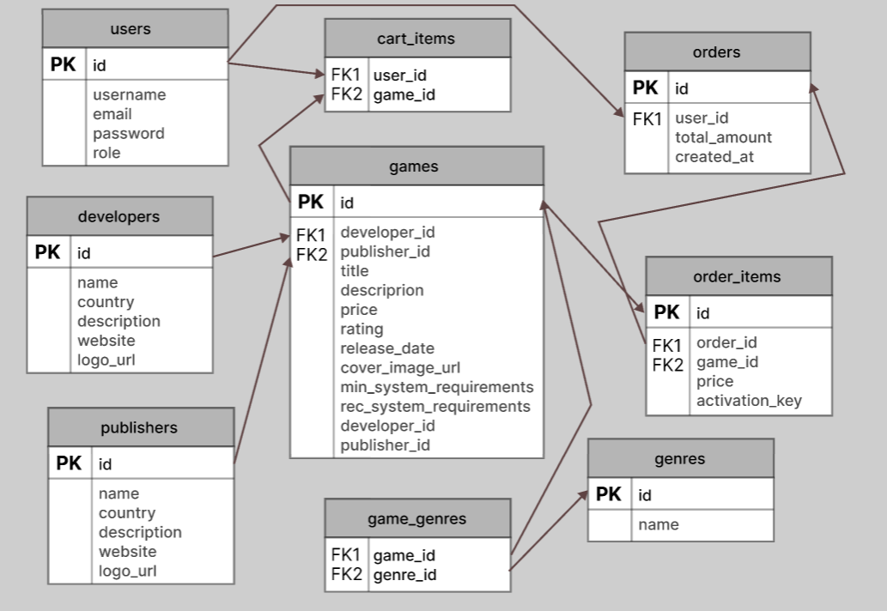

# GameFreedom

Сайт-магазин цифрових відеоігор. Тут можна подивитись список ігор, знайти потрібну, додати її в кошик і купити.

---

## Опис проєкту

Ідея схожа на спрощений Steam. Є каталог ігор, у кожної гри є своя сторінка з описом, ціною та системними вимогами. Ігри мають розробника (студія, яка зробила гру) і видавця (компанія, яка її випускає), а також один або кілька жанрів.

### Що можна робити на сайті

**Будь-який відвідувач:**
- дивитись список ігор;
- шукати гру за назвою;
- фільтрувати за жанром, розробником, видавцем і ціною;
- сортувати за ціною, рейтингом і датою виходу;
- відкрити сторінку окремої гри;
- подивитись сторінки розробників і видавців (там усі їхні ігри);
- прочитати сторінку «Про нас» (контакти, повернення коштів);
- зареєструватись і залогінитись.

**Залогінений користувач:**
- має профіль, де можна змінити дані про себе;
- додає ігри в кошик і видаляє їх звідти;
- натискає «Купити», і створюється замовлення (без оплати, для спрощення);
- бачить історію замовлень;
- бачить свою бібліотеку куплених ігор.

**Адміністратор:**
- додає, редагує і видаляє ігри, розробників, видавців і жанри.

---

## Ендпоінти API

Дані передаються у форматі JSON. Усі шляхи починаються з `/api`.

> **не вчив:** тут будуть ендпоінти тільки для залогінених, а авторизацію ми ще не вчили тому потім вирішимо про це

### Реєстрація і вхід

#### POST `/api/auth/register`
Створює нового користувача.

Request body:
```json
{
  "username": "gamer99",
  "email": "gamer99@example.com",
  "password": "12345678"
}
```
Response: `201 Created`
```json
{
  "id": 1,
  "username": "gamer99",
  "email": "gamer99@example.com"
}
```
Якщо email уже зайнятий, повертається `400 Bad Request`.

#### POST `/api/auth/login`
Вхід в акаунт.

Request body:
```json
{
  "email": "gamer99@example.com",
  "password": "12345678"
}
```
Response: `200 OK`
```json
{
  "id": 1,
  "username": "gamer99",
  "email": "gamer99@example.com"
}
```
Якщо email або пароль неправильні, повертається `401 Unauthorized`.

> **потім:** що саме повертати після логіну вирішимо коли дійдемо до авторизації

---

### Профіль користувача користувач

#### GET `/api/users/me`
Отримати дані свого профілю.

Response: `200 OK`
```json
{
  "id": 1,
  "username": "gamer99",
  "email": "gamer99@example.com"
}
```

#### PUT `/api/users/me`
Змінити дані профілю.

Request body:
```json
{
  "username": "pro_gamer"
}
```
Response: `200 OK`
```json
{
  "id": 1,
  "username": "pro_gamer",
  "email": "gamer99@example.com"
}
```

---

### Ігри

#### GET `/api/games`
Список ігор для головної сторінки каталогу.

Query-параметри (всі необов'язкові):

| Параметр | Що робить |
|----------|-----------|
| `search` | пошук за назвою |
| `genre_id` | фільтр за жанром |
| `developer_id` | фільтр за розробником |
| `publisher_id` | фільтр за видавцем |
| `min_price`, `max_price` | діапазон ціни |
| `sort_by` | сортування: `price`, `rating` або `release_date` |
| `order` | `asc` (за зростанням) або `desc` (за спаданням) |

Приклад запиту: `/api/games?genre_id=1&sort_by=price&order=asc`

Response: `200 OK`
```json
[
  {
    "id": 10,
    "title": "Cyber Odyssey 2088",
    "price": 59.99,
    "rating": 4.8,
    "release_date": "2025-11-20",
    "cover_image_url": "https://example.com/cyber.jpg",
    "developer": { "id": 2, "name": "Neon Interactive" },
    "publisher": { "id": 1, "name": "Global Games" },
    "genres": [
      { "id": 1, "name": "RPG" },
      { "id": 3, "name": "Action" }
    ]
  }
]
```


#### GET `/api/games/{id}`
Сторінка однієї гри з повною інформацією.

Response: `200 OK`
```json
{
  "id": 10,
  "title": "Cyber Odyssey 2088",
  "description": "Рольова гра у кіберпанковому місті.",
  "price": 59.99,
  "rating": 4.8,
  "release_date": "2025-11-20",
  "cover_image_url": "https://example.com/cyber.jpg",
  "min_system_requirements": "Windows 10, 12 GB RAM, GTX 1060",
  "rec_system_requirements": "Windows 11, 16 GB RAM, RTX 3070",
  "developer": { "id": 2, "name": "Neon Interactive" },
  "publisher": { "id": 1, "name": "Global Games" },
  "genres": [
    { "id": 1, "name": "RPG" }
  ]
}
```
Якщо гри з таким id немає, повертається `404 Not Found`.

#### POST `/api/games`  адмін
Додати нову гру.

Request body:
```json
{
  "title": "Mystic Realms",
  "description": "Фентезійна стратегія.",
  "price": 39.99,
  "release_date": "2026-03-15",
  "cover_image_url": "https://example.com/mystic.jpg",
  "min_system_requirements": "Windows 10, 8 GB RAM",
  "rec_system_requirements": "Windows 11, 16 GB RAM",
  "developer_id": 3,
  "publisher_id": 2,
  "genre_ids": [2, 4]
}
```
Response: `201 Created`
```json
{
  "id": 11,
  "title": "Mystic Realms",
  "price": 39.99
}
```

#### PATCH `/api/games/{id}`  адмін
Редагувати гру (можна передати тільки ті поля, які міняємо).

Request body:
```json
{
  "price": 29.99
}
```
Response: `200 OK`
```json
{
  "id": 11,
  "title": "Mystic Realms",
  "price": 29.99
}
```

#### DELETE `/api/games/{id}`  адмін
Видалити гру.

Response: `204 No Content` (body немає).

---

### Розробники

| Метод | Шлях | Для чого | Хто | Статус |
|-------|------|----------|-----|--------|
| GET | `/api/developers` | список усіх розробників | усі | `200 OK` |
| GET | `/api/developers/{id}` | сторінка розробника | усі | `200 OK` |
| GET | `/api/developers/{id}/games` | усі ігри розробника | усі | `200 OK` |
| POST | `/api/developers` | додати розробника | адмін | `201 Created` |
| PUT | `/api/developers/{id}` | редагувати розробника | адмін | `200 OK` |
| DELETE | `/api/developers/{id}` | видалити розробника | адмін | `204 No Content` |

Приклад відповіді для `GET /api/developers/{id}`:
```json
{
  "id": 2,
  "name": "Neon Interactive",
  "country": "Ukraine",
  "description": "Українська інді-студія.",
  "website": "https://neon.example.com",
  "logo_url": "https://example.com/neon.png"
}
```

Приклад відповіді для `GET /api/developers/{id}/games`:
```json
[
  {
    "id": 10,
    "title": "Cyber Odyssey 2088",
    "price": 59.99,
    "cover_image_url": "https://example.com/cyber.jpg"
  }
]
```

Request body для `POST` і `PUT` (при `PUT` можна передати тільки частину полів):
```json
{
  "name": "Neon Interactive",
  "country": "Ukraine",
  "description": "Українська інді-студія.",
  "website": "https://neon.example.com",
  "logo_url": "https://example.com/neon.png"
}
```

---

### Видавці

Працюють так само, як розробники, тільки шлях `/api/publishers`.

| Метод | Шлях | Для чого | Хто | Статус |
|-------|------|----------|-----|--------|
| GET | `/api/publishers` | список усіх видавців | усі | `200 OK` |
| GET | `/api/publishers/{id}` | сторінка видавця | усі | `200 OK` |
| GET | `/api/publishers/{id}/games` | усі ігри видавця | усі | `200 OK` |
| POST | `/api/publishers` | додати видавця | адмін | `201 Created` |
| PUT | `/api/publishers/{id}` | редагувати видавця | адмін | `200 OK` |
| DELETE | `/api/publishers/{id}` | видалити видавця | адмін | `204 No Content` |

Request body і response body такі самі, як у розробників.

---

### Жанри

| Метод | Шлях | Для чого | Хто | Статус |
|-------|------|----------|-----|--------|
| GET | `/api/genres` | список жанрів (для фільтра) | усі | `200 OK` |
| POST | `/api/genres` | додати жанр | адмін | `201 Created` |
| PUT | `/api/genres/{id}` | редагувати жанр | адмін | `200 OK` |
| DELETE | `/api/genres/{id}` | видалити жанр | адмін | `204 No Content` |

Response для `GET /api/genres`:
```json
[
  { "id": 1, "name": "RPG" },
  { "id": 2, "name": "Strategy" }
]
```

Request body для `POST` і `PUT`:
```json
{
  "name": "Horror"
}
```

---

### Кошик  користувач

#### GET `/api/cart`
Показати, що лежить у кошику.

Response: `200 OK`
```json
{
  "items": [
    {
      "game_id": 10,
      "title": "Cyber Odyssey 2088",
      "price": 59.99
    }
  ],
  "total_price": 59.99
}
```

#### POST `/api/cart/items`
Додати гру в кошик.

Request body:
```json
{
  "game_id": 10
}
```
Response: `201 Created`
```json
{
  "game_id": 10,
  "title": "Cyber Odyssey 2088"
}
```
Якщо гра вже є в кошику, повертається `400 Bad Request`.

#### DELETE `/api/cart/items/{game_id}`
Прибрати одну гру з кошика.

Response: `204 No Content`

#### DELETE `/api/cart`
Очистити весь кошик.

Response: `204 No Content`

---

### Замовлення і бібліотека  користувач

#### POST `/api/orders`
Купити все, що лежить у кошику. Створюється замовлення, кошик очищається. Request body не потрібен, бо оплату поки не робимо.

Response: `201 Created`
```json
{
  "id": 101,
  "total_amount": 59.99,
  "created_at": "2026-10-13T14:00:00Z",
  "items": [
    {
      "game_id": 10,
      "title": "Cyber Odyssey 2088",
      "price": 59.99,
      "activation_key": "ABCD-1234-EFGH"
    }
  ]
}
```
Якщо кошик порожній, повертається `400 Bad Request`.

#### GET `/api/orders`
Історія замовлень.

Response: `200 OK`
```json
[
  {
    "id": 101,
    "total_amount": 59.99,
    "created_at": "2026-10-13T14:00:00Z"
  }
]
```

#### GET `/api/orders/{id}`
Одне замовлення з іграми всередині.

Response: `200 OK` (такий самий, як відповідь на `POST /api/orders`).

#### GET `/api/library`
Усі ігри, які користувач уже купив.

Response: `200 OK`
```json
[
  {
    "game_id": 10,
    "title": "Cyber Odyssey 2088",
    "cover_image_url": "https://example.com/cyber.jpg",
    "activation_key": "ABCD-1234-EFGH"
  }
]
```

---

### Сторінка «Про нас»

#### GET `/api/about`
Контакти, інформація про повернення коштів.

Response: `200 OK`
```json
{
  "description": "GameFreedom — магазин цифрових ігор.",
  "email": "support@gamefreedom.example.com",
  "phone": "+380 44 123 45 67",
  "refund_policy": "Гроші можна повернути протягом 14 днів, якщо ключ ще не активовано."
}
```

---

## Схема бази даних



### Таблиці

| Таблиця | Поля |
|---------|------|
| `users` | id, username, email, password, role (user/admin) |
| `developers` | id, name, country, description, website, logo_url |
| `publishers` | id, name, country, description, website, logo_url |
| `genres` | id, name |
| `games` | id, title, description, price, rating, release_date, cover_image_url, min_system_requirements, rec_system_requirements, developer_id, publisher_id |
| `game_genres` | game_id, genre_id |
| `cart_items` | user_id, game_id |
| `orders` | id, user_id, total_amount, created_at |
| `order_items` | id, order_id, game_id, price, activation_key |

### Зв'язки

- Одна гра має одного розробника і одного видавця, а в розробника і видавця може бути багато ігор (**один до багатьох**).
- Гра може мати кілька жанрів, а жанр може бути в багатьох іграх (**багато до багатьох**), для цього є таблиця `game_genres`.
- Користувач може мати багато ігор у кошику (таблиця `cart_items`).
- Користувач може мати багато замовлень, а в замовленні може бути багато ігор (таблиця `order_items`).
- Ціну в `order_items` зберігаємо окремо, щоб історія замовлень не змінювалась, якщо гра потім подорожчає чи подешевшає.

---

## Що ще можна додати

- Оплата, поки замовлення створюється одразу, без грошей.
- Відгуки та оцінки від користувачів
- Вішліст
